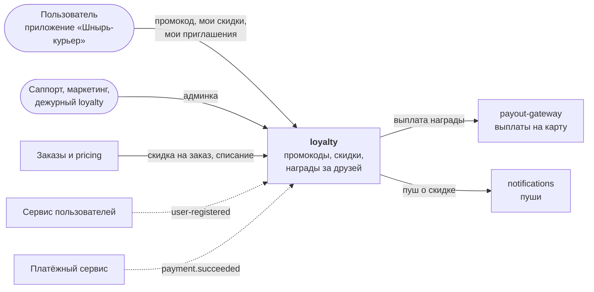
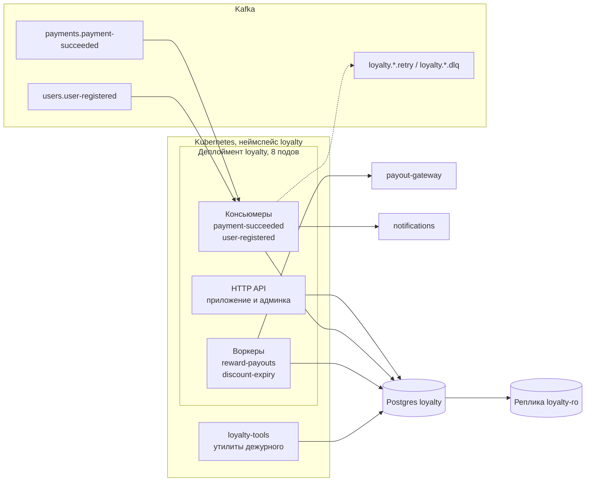
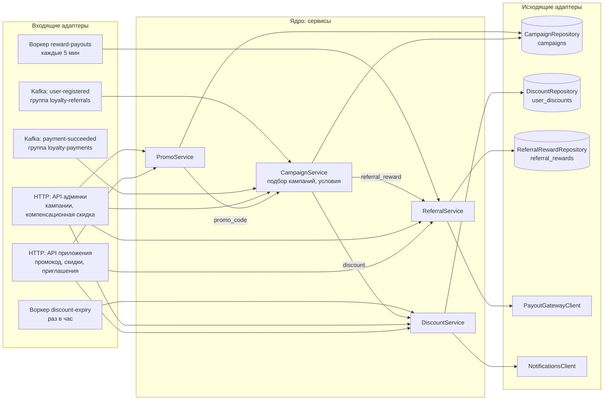
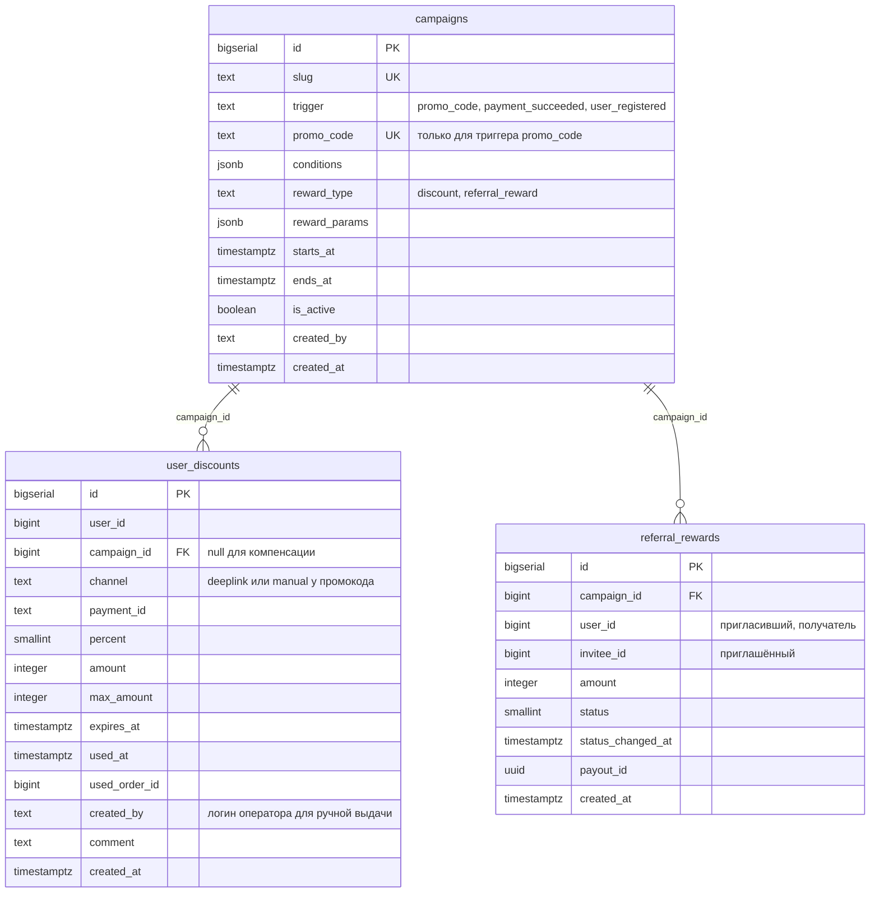

# loyalty

Бэкенд программы лояльности приложения «Шнырь-курьер» (такси и доставка): промокоды, скидки на следующий заказ, награды за приглашённых друзей. Рынки: Россия, Казахстан, Узбекистан, Кыргызстан. Владелец: команда `loyalty`, дежурный канал `#loyalty-duty`.

Сервис написал подрядчик «Северсофт», в феврале 2026 года код передан команде архивом.

## Как устроено

Любая механика лояльности это кампания: **триггер → условия → награда**. Кампании заводятся в админке и лежат в таблице `campaigns`. Значения условий и параметры наград (проценты, сроки, суммы) живут в строках кампаний, в коде их нет.

| Триггер | Откуда приходит | Пример кампании |
|---|---|---|
| `promo_code` | Пользователь ввёл промокод в приложении или открыл ссылку `shnyr://promo?code=…` | Промокод на скидку |
| `payment_succeeded` | Событие оплаты заказа от платёжной команды | Скидка на следующий заказ за товары из акции |
| `user_registered` | Событие регистрации от сервиса пользователей | Награда пригласившему за друга |

| Тип награды | Что это | Таблица |
|---|---|---|
| `discount` | Скидка на заказ: процент с потолком или фиксированная сумма, со сроком действия. Списывается при заказе | `user_discounts` |
| `referral_reward` | Деньги пригласившему на карту через `payout-gateway` | `referral_rewards` |

Глобальные лимиты, общие для всех кампаний, лежат в `config/app.yaml`.

### Контекст



Сплошные стрелки это синхронные HTTP-вызовы, пунктир это события Kafka.

### Контейнеры



API, консьюмеры и воркеры работают в каждом поде одного деплоймента, на все страны сразу. Read-реплика `loyalty-ro` доступна только разработчикам команды.

### Компоненты приложения

Гексагональная архитектура: входящие адаптеры (HTTP-ручки, консьюмеры, воркеры) вызывают сервисы ядра, сервисы ходят наружу только через порты, порты реализуют исходящие адаптеры (репозитории Postgres и HTTP-клиенты).



## Модули

| Модуль | Что делает | Таблицы |
|---|---|---|
| `promo` | Ввод промокода: приводит ввод к виду кода (trim, верхний регистр), ищет кампанию по `campaigns.promo_code` и передаёт её в `campaigns` | Читает `campaigns` |
| `campaigns` | На триггер подбирает активные кампании, проверяет условия выдачи и выдаёт награду её типа | `campaigns` |
| `discounts` | Скидки: выдача по кампании и компенсационная из админки, проверка условий заказа и списание, гашение истёкших, пуш о новой скидке | `user_discounts` |
| `referrals` | Награды за друзей: создание, статусы, выплата на карту через `payout-gateway` | `referral_rewards` |
| `admin` | Ручки админки: кампании (включая промокодные), компенсационная скидка, награды пользователя | Пишет через остальные модули |

Условия кампании двух видов:

| Вид | Кто проверяет | Условия |
|---|---|---|
| Условия выдачи | `CampaignService` при триггере, по данным события или запроса приложения | `countries`, `segment`, `city_ids`, `per_user_limit`, `max_activations`, `sku_ids`, `payment_methods`, `invited` |
| Условия заказа | `DiscountService` при списании скидки | `time_from`, `time_to`, `min_order_amount` |

## Консьюмеры

| Консьюмер | Топик | Группа | Что делает |
|---|---|---|---|
| `payment-succeeded` | `payments.payment-succeeded` | `loyalty-payments` | Для активных кампаний с триггером `payment_succeeded` проверяет условия; подошла кампания со скидкой → скидка на следующий заказ → пуш |
| `user-registered` | `users.user-registered` | `loyalty-referrals` | Для активных кампаний с триггером `user_registered` проверяет условия (регистрация по приглашению: в событии есть `invited_by`) и создаёт награду пригласившему в статусе `Pending` |

Схемы событий: `api/events/`. Настройки групп: `config/consumers.yaml`.

## Воркеры

| Воркер | Расписание | Что делает |
|---|---|---|
| `reward-payouts` | При старте пода и дальше каждые 5 минут | Проходит награды в статусе `Pending` батчами и выплачивает их через `payout-gateway` с `idempotency_key` = id награды. Выплачено → `Paid`. У пользователя нет карты для выплат → награда остаётся `Pending` до следующего прохода |
| `discount-expiry` | Раз в час | Гасит истёкшие скидки |

Воркеры запускаются в каждом поде. Расписания: `config/workers.yaml`.

## Внешние зависимости

| Сервис | Владелец | Зачем | Спека |
|---|---|---|---|
| `payout-gateway` | Платёжная команда | Выплата награды на карту. Карты пользователей хранит он | `api/payout-gateway.yaml` |
| `notifications` | Команда CRM | Пуши пользователям | `api/notifications.yaml` |

В `api/` также лежат спеки соседних сервисов, которые мы пока не вызываем: `antifraud.yaml` (команда антифрода) и `order-history.yaml` (команда истории заказов).

## Платформа

| Что | Как |
|---|---|
| Консьюмеры | Обвязка платформы: сама читает топик, вызывает обработчик с дедлайном `processing_timeout`, коммитит оффсет после успешной обработки. Ошибка или дедлайн → повтор через ретрай-топик, после `retry.max_attempts` попыток сообщение уходит в DLQ. Непустой DLQ пейджит дежурного |
| Значения по умолчанию | `${PLATFORM_DEFAULT}` в конфигах подставляет платформа, у всех сервисов одинаково |
| Миграции | `migrations/`, только DDL. Катит платформенный пайплайн до деплоя приложения |
| Деплой | Один деплоймент `loyalty`, 8 подов |

## Данные



Один промокод это одна кампания. Пачка промокодов для партнёра это пачка кампаний с общим префиксом `slug` (`partner_pulse_oct_0001`, `partner_pulse_oct_0002`, …), её заводит дежурный скриптом (`docs/oncall_runbook.md`). Суммы в `reward_params` указаны в валюте страны кампании.

## Структура репозитория

```
README.md, CLAUDE.md, AGENTS.md
api/                 наш API (loyalty-api.yaml), спеки соседних сервисов
api/events/          схемы входящих событий
migrations/          DDL
config/              app.yaml, consumers.yaml, workers.yaml
docs/                ранбук дежурного, инструкция поддержки, роли админки
```
